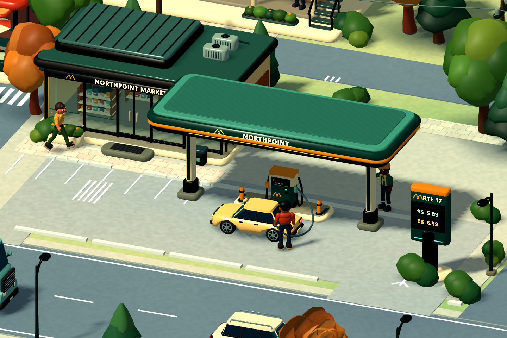

# Galeria 3D · Trasa 17

Scenę gry i plansze modeli zarejestrowano bezpośrednio z viewportu Godota 4.7.2. Plansze floty, postaci i architektury korzystają z tych samych zasobów GLB, materiałów i animacji co lokalizacja.

## Stacja w grze

- [Widok telefonu po uruchomieniu](01-stacja-w-grze.png)
- [Cała lokalizacja w świetle dziennym](02-mapa-dzien.png)
- [Zbliżenie stacji podczas tankowania](03-stacja-detal.png)
- [Złota godzina](04-mapa-zlota-godzina.png)
- [Wieczór](05-mapa-wieczor.png)
- [Noc i oświetlone stanowisko](06-stacja-noc.png)
- [Monety po płatności](07-monety-sprzedaz.png)
- [Efekt zakupu konstrukcji](08-rozbudowa-efekt.png)
- [Rozwinięta stacja poziomu 5](09-stacja-poziom-5.png)
- [Poziom 5 z interfejsem](10-poziom-5-w-grze.png)
- [Myjnia podczas pracy](15-myjnia-woda.png)

## Zasoby

- [Zbliżenie sedana, samochodu sportowego i zestawu z naczepą](11-samochody-detal.png)
- [Komplet 20 pojazdów](12-flota-20-modeli.png)
- [Pracownicy, klientka i kierowca](13-postacie.png)
- [Sklep, myjnia, restauracja, warsztat, motel i parking](14-architektura.png)

