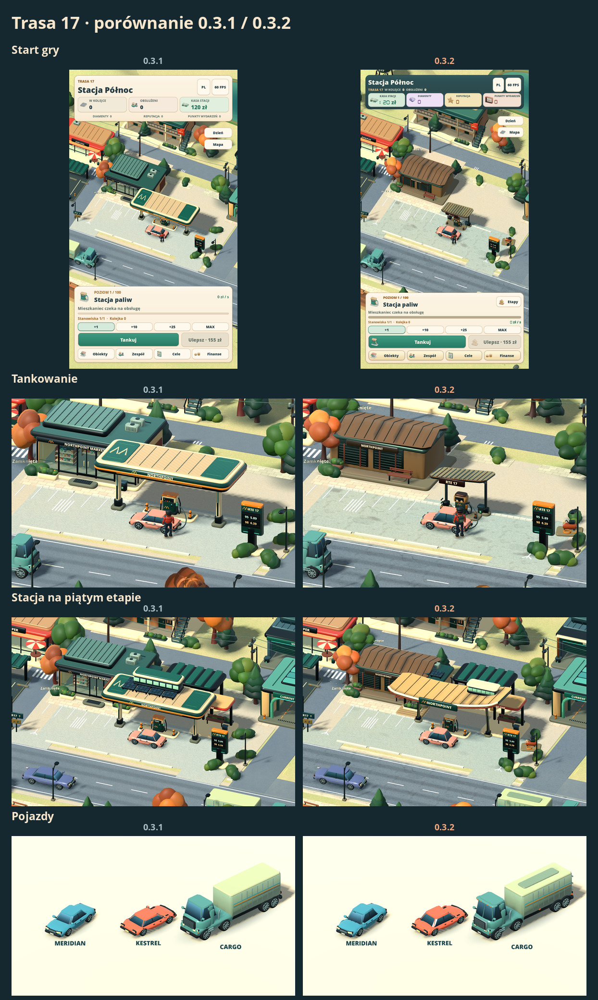
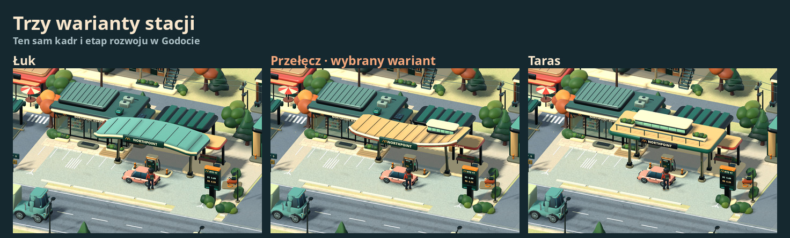

# Trasa 17 · przebudowa 0.3.2

[Porównanie z wersją 0.3.1](porownanie-0.3.1.jpg) · [Plansza trzech wariantów](warianty-stacji.jpg) · [Przegląd geometrii i materiałów](../../ART_DIRECTION.md#032--od-przydrożnego-punktu-do-przełęczy)

Kadry bazowe pochodzą z commitu `7ea8bf9`. Zdjęcia 0.3.2 wykonano w oknie Godota 4.7.2 w scenie gry i na planszach modeli. Plansze porównawcze skalują i zestawiają oryginalne ujęcia. [Źródłowa galeria 0.3.1](../README.md)

## Trzy warianty

Wszystkie warianty stoją w tej samej scenie na poziomie 5. Wspólny kadr pokazuje wpływ podpór, skrajni i profilu dachu na widoczność stanowiska.

| Wariant | Kadr z Godota |
| --- | --- |
| Łuk z obłymi zakończeniami i emalią | [Otwórz](variants/01-luk.jpg) |
| Wybrana Przełęcz z asymetryczną powłoką i świetlikiem | [Otwórz](variants/02-przelecz.jpg) |
| Taras z balustradą i zielenią | [Otwórz](variants/03-taras.jpg) |

## Pięć etapów w grze

- [Poziom 1 · Wiata, stary dystrybutor i zamknięty sklep](game/01-stacja-w-grze.jpg)
- [Poziom 2 · Rozbudowana wiata i miejsce odpoczynku](game/stacja-etap-2.jpg)
- [Poziom 3 · Świetlik i skrzydło serwisowe](game/stacja-etap-3.jpg)
- [Poziom 4 · Wiata wspornikowa i plac usługowy](game/stacja-etap-4.jpg)
- [Poziom 5 · Przełęcz z łącznikiem](game/09-stacja-poziom-5.jpg) · [Widok telefonu](game/10-poziom-5-w-grze.jpg)
- [Panel etapów otwarty w teście rozgrywki](game/19-panel-etapow.jpg)

## Kompleks w ruchu

- [Mapa za dnia](game/02-mapa-dzien.jpg) · [Złota godzina](game/04-mapa-zlota-godzina.jpg) · [Noc](game/06-stacja-noc.jpg)
- [Zbliżenie tankowania](game/03-stacja-detal.jpg) · [Płatność](game/07-monety-sprzedaz.jpg) · [Pracownik tankuje samodzielnie](game/20-pracownik.jpg)
- [Praca myjni](game/15-myjnia-woda.jpg) · [Naprawa w warsztacie](game/17-warsztat-pracuje.jpg) · [Klient w drodze do witryny](game/18-klient-sklepu.jpg)
- [Personel i przełączanie menedżerów](game/21-zespol.jpg) · [Układ tabletu](game/22-tablet.jpg)
- [Pełna mapa z odblokowanym placem TIR i dachami w etapie 90](game/16-pelny-kompleks.jpg)

## Plansze modeli

- [Sedan, samochód sportowy i zestaw ciężarowy](game/11-samochody-detal.jpg)
- [Komplet 20 pojazdów](game/12-flota-20-modeli.jpg)
- [Postacie w klipach pracy](game/13-postacie.jpg)

[Wyniki testów i liczba trójkątów modeli](../../TEST_REPORT.md)
