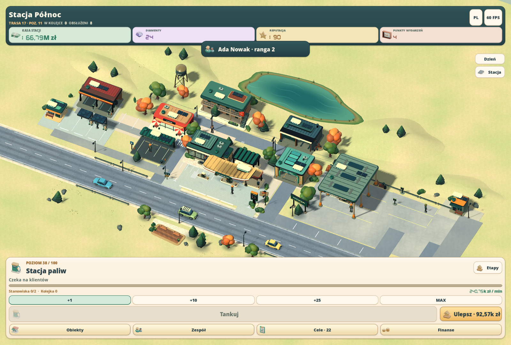

# Highway Business Tycoon 0.4.0 · zrzuty z Godota

19 kadrów pochodzi z działającego projektu w Godocie 4.7.2. Pierwszą zmianę wykonano przez kliknięcia w kontrolki. Dalsza próba zaczyna od szerszego budżetu testowego, następnie używa normalnych zakupów, ruchu, animacji, płatności i zapisu. Zrzuty pokazują rzeczywiste okno gry.

## Pierwsza zmiana

- [Samouczek na starcie](01-pierwsza-zmiana.jpg)
- [Tankowanie pierwszego auta](02-tankowanie.jpg)
- [Pierwszy zarobek i zakup](03-pierwszy-zarobek.jpg)
- [Początkowe misje z podświetleniem](04-kariera-i-pierwsze-cele.jpg)
- [Zatrudnienie pracownika](05-zatrudnienie.jpg)
- [Pracownik na stanowisku](06-pracownik-na-stanowisku.jpg)
- [Wpływy w kasie](07-odbiory-z-kasy.jpg)
- [Usługi Trasy 17](08-uslugi-trasy17.jpg)

## Obsługa i kompleks

- [Wulkanizacja](09-wulkanizacja.jpg)
- [Ładowanie EV](10-ladowanie-ev.jpg)
- [Parking TIR](11-parking-tir.jpg)
- [Klient restauracji](12-klient-restauracji.jpg)
- [Cała mapa](17-pelny-kompleks.jpg)

## Rozwój i zapis

- [Rozdziały i postęp misji](13-rozdzialy.jpg)
- [Poziom gracza i dostępna nagroda](14-nagrody-poziomu.jpg)
- [Karty menedżerów po awansie Ady](15-menedzerowie.jpg)
- [Rozwój limitu offline](16-limit-offline.jpg)
- [Podsumowanie nieobecności po wczytaniu](18-podsumowanie-offline.jpg)
- [Angielski układ tabletowy](19-tablet-en.jpg)

[Raport rozgrywki i zapisu](../../TEST_REPORT.md) · [Raport balansu](../../docs/balance-0.4.0.md)
