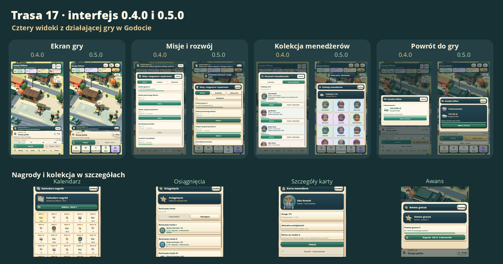

# Trasa 17 · galeria 0.5.0

30 kadrów z działającej gry, zapisanych z okna Godota 4.7.2. Test obsługuje elementy interfejsu tak jak gracz. W dalszej części używa osobnego profilu testowego do otwarcia całego kompleksu i sprawdzenia wypłaty offline. Porównanie korzysta z czterech analogicznych widoków z faktycznej galerii 0.4.0. [Porównanie](porownanie-0.4.0.jpg) · [16 sekund rozgrywki z dźwiękiem](rozgrywka.mp4)

| Kadr | Widok |
| --- | --- |
| 01–05 | [Menu startowe](01-start.jpg), [ładowanie](02-ladowanie.jpg), [HUD](03-hud.jpg), [tankowanie](04-tankowanie.jpg), [filmowa modernizacja](05-modernizacja.jpg) |
| 06–10 | [Misje](06-misje.jpg), [pracownicy](07-pracownicy.jpg), [przyznanie karty](08-nowa-karta.jpg), [kolekcja](09-kolekcja.jpg), [szczegóły karty](10-karta-menedzera.jpg) |
| 11–15 | [Poziomy i etapy budynku](11-modernizacja-panel.jpg), [obiekty](12-obiekty.jpg), [kalendarz](13-kalendarz.jpg), [odbiór nagrody](14-nagroda.jpg), [rozdziały misji](15-rozdzialy.jpg) |
| 16–20 | [Osiągnięcia](16-osiagniecia.jpg), [awans](17-awans.jpg), [sklep](18-sklep.jpg), [finanse](19-statystyki.jpg), [ustawienia](20-ustawienia.jpg) |
| 21–26 | [Pomoc](21-pomoc.jpg), [licencje](22-licencje.jpg), [prywatność](23-prywatnosc.jpg), [otwarta brama warsztatu](24-brama-warsztatu.jpg), [dostawa sklepu](25-dostawa.jpg), [zarobki offline](26-offline.jpg) |
| 27–30 | [Telefon](27-telefon.jpg), [tablet](28-tablet.jpg), [szerokie okno](29-tablet-szeroki.jpg), [symulowane wycięcie](30-wyciecie.jpg) |
