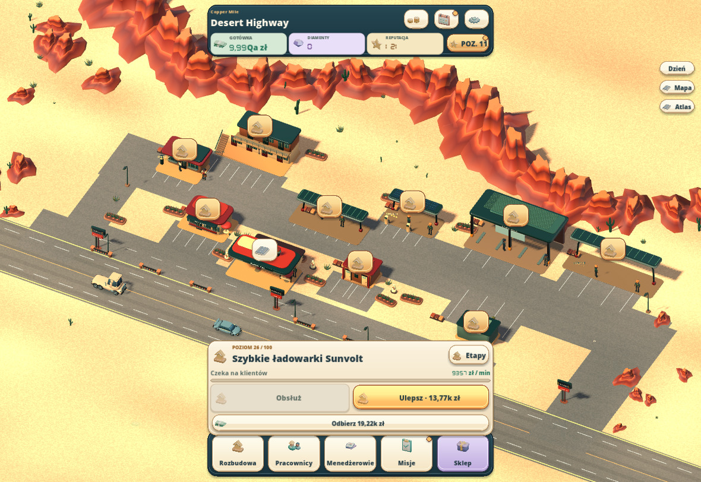

# Highway Business Tycoon 0.6.0 · Copper Mile

39 klatek zapisanych z okna Godota. Przejście klika w atlas, kupuje wstęp, tankuje i uruchamia obsługę aut i ciężarówek. Od dalszych kadrów odblokowuje sprzęt na profilu testowym. Sześć dat testowych uruchamia rzeczywiste rundy w silniku. [Nagranie podróży, tankowania i ulepszenia z dźwiękiem](podroz-copper-mile.mp4)

| Kadry | Widoki |
| --- | --- |
| 01–05 | [Stacja Północ](01-stacja-polnoc.jpg), [atlas](02-atlas.jpg), [bramka Desert Highway](03-desert-warunki.jpg), [plan Green Valley](04-green-valley-plan.jpg), [animacja podróży](05-podroz.jpg) |
| 06–10 | [Otwarcie Copper Mile](06-copper-mile-start.jpg), [tankowanie](07-pierwsze-tankowanie.jpg), [etapy](08-etapy-copper-mile.jpg), [kawiarnia](09-kawiarnia.jpg), [toalety](10-toalety.jpg) |
| 11–17 | [Parking VIP](11-parking-vip.jpg), [serwis TIR](12-serwis-tir.jpg), [prysznice](13-prysznice.jpg), [motel](14-motel.jpg), [parking TIR](15-parking-tir.jpg), [grill drive-through](16-drive-through.jpg), [ładowarki](17-ladowarki.jpg) |
| 18–24 | [Cała mapa](18-caly-kompleks.jpg), [poranek](19-poranek.jpg), [zachód słońca](20-zachod.jpg), [noc](21-neony-noca.jpg), [ustawienia pogody](22-pogoda.jpg), [pustynny wiatr](23-pustynny-wiatr.jpg), [deszcz](24-deszcz.jpg) |
| 25–27 | [Kontrakty](25-kontrakty.jpg), [samochody](26-kolekcja-pojazdow.jpg), [ciężarówki](27-kolekcja-ciezarowek.jpg) |
| 28–34 | [Zimowa autostrada](28-wydarzenie-snow.jpg), [Świąteczne imperium](29-wydarzenie-holiday.jpg), [Festiwal samochodów sportowych](30-wydarzenie-sport.jpg), [Tydzień ciężarówek](31-wydarzenie-truck.jpg), [Wakacyjny kurort](32-wydarzenie-summer.jpg), [Ekologiczna autostrada](33-wydarzenie-green.jpg), [podsumowanie](34-podsumowanie-wydarzen.jpg) |
| 35–39 | [Finanse](35-finanse-desert.jpg), [warunki prestiżu](36-prestiz-warunki.jpg), [potwierdzenie prestiżu](37-potwierdzenie-prestizu.jpg), [dochód po powrocie na Trasę 17](38-powrot-i-offline.jpg), [panorama](39-panorama.jpg) |
