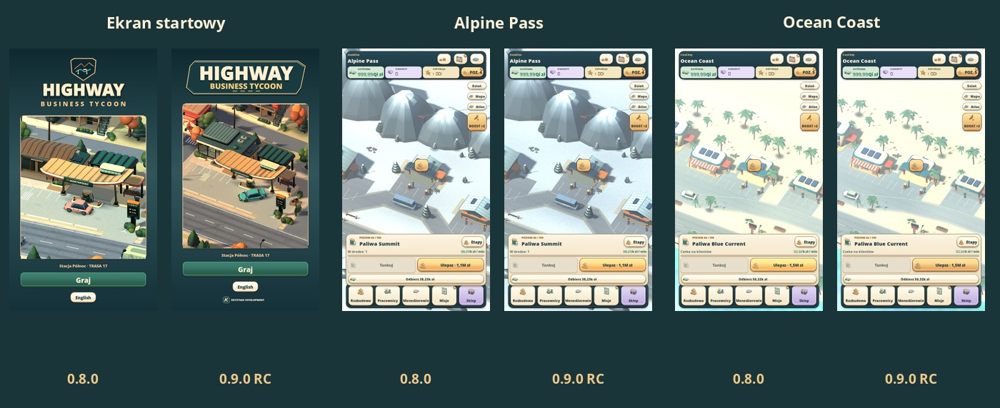

# Galeria wersji 0.9.0 Release Candidate

88 nowych kadrów pochodzi z renderowanej gry w Godot 4.7.2 na Linuksie. Scenariusze QA przygotowują powtarzalny stan rozwoju i ruch, korzystając z właściwych scen, interfejsu i mechanik. Kadry BOOST z adnotacją „aktywny” używają kontrolowanego potwierdzenia adaptera testowego. Rozdzielczości tabletu ustawiono na rzeczywistym oknie Godota. [Próby i ograniczenia](../../TEST_REPORT.md)

## Lokalizacje i sceny

| Mapa | Panorama | Działające stanowiska |
| --- | --- | --- |
| Stacja Północ | [Rozwinięta stacja](after/regions/06-polnoc-panorama.jpg) | [Tankowanie](after/regions/02-polnoc-tankowanie.jpg) |
| Desert Highway | [Copper Mile](after/regions/13-copper-mile-panorama.jpg) | [Red Mesa](after/regions/10-red-mesa-serwis.jpg) · [Dust & Bean](after/regions/09-dust-and-bean.jpg) |
| Green Valley | [Dolina](after/regions/16-green-valley-panorama.jpg) | [Warsztat](after/regions/19-mill-i-motor.jpg) · [Dostawa](after/regions/20-greenbank-dostawa.jpg) |
| Alpine Pass | [Przełęcz](after/regions/23-alpine-panorama.jpg) | [Autokar](after/regions/25-snowline-autokar.jpg) · [Restauracja](after/regions/26-ember-hearth.jpg) |
| Ocean Coast | [Zatoka](after/regions/28-ocean-coast-panorama.jpg) | [Myjnia](after/regions/32-pearl-bay-myjnia.jpg) · [Parking VIP](after/regions/30-marina-vip.jpg) |
| Metro City | [Dzień](after/regions/36-metro-panorama-dzien.jpg) · [Noc](after/regions/34-metro-panorama-noc.jpg) | [Rozładunek](after/regions/37-terminal-zaladunek.jpg) · [Salon](after/regions/39-apex-motors.jpg) · [Ładowanie EV](after/regions/41-pulse-plaza.jpg) |

[51 ujęć rozgrywki i regionów](after/regions/) · [Ekran startu, przejście samouczka i ekrany rozwoju](after/ui/) · [Sklep, BOOST i prywatność](after/boost/) · [Układy tabletowe i start EN](after/tablets/)

## Porównania

- [Start 0.8.0](before/01-start.png) i [start 0.9.0](after/ui/01-start.png)
- [Rozbudowa 0.8.0](before/12-obiekty.png) i [następna inwestycja 0.9.0](after/ui/12-obiekty.png)
- [Sześć map 0.8.0](before/) i [te same ustawienia kamer 0.9.0](after/profiles/)

## Nagranie

[Nagranie rozgrywki MP4](rozgrywka.mp4) zawiera 616 klatek przy 30 kl./s, oryginalny miks gry, podróż do Metro City, rozliczoną dostawę i Green Valley. Ustawienia kamery i stan kampanii przygotowano w teście Godota Movie Maker. [Scenariusz](../../tests/regional_recording.gd) · [Wybór ujęć Google Play](../../release/play/)
