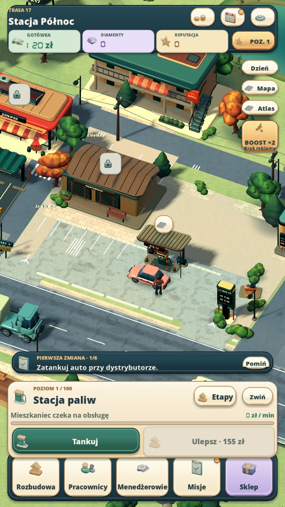

# Premium Graphics 2.0 w Godocie

Sceny zarejestrowano w Highway Business Tycoon z rendererem Compatibility. Kadry portretowe pokazują normalny tryb gry i jej panele. Szerokie ujęcia wnętrz i map pochodzą z kamer dokumentacyjnych, a plansze floty i pracowników z próbnego studia Godota z tymi samymi modelami i materiałami. [Raport modeli](../../docs/PREMIUM_GRAPHICS_2.md) · [Procedura pomiarów](../../docs/PERFORMANCE_093.md)

## 0.9.2 i 0.9.3 w tym samym kadrze

Każda para pokazuje odpowiednią scenę w obu wersjach. Kompozycje dodają podpisy i skalują obrazy. [Plansza Północy](porownanie-polnoc.jpg) · [Plansza wszystkich sześciu regionów](porownanie-regionow.jpg) · [Kadry bazowe](before/) · [Ujęcia testowe przed i po](benchmark/)

| Scena | 0.9.2 | 0.9.3 |
| --- | --- | --- |
| Standardowy widok i interfejs | [Przed](before/01-stacja-w-grze.jpg) | [Po](after/north/01-stacja-w-grze.jpg) |
| Cała Stacja Północ | [Przed](before/02-mapa-dzien.jpg) | [Po](after/north/02-mapa-dzien.jpg) |
| Zadaszenie ostatniego etapu | [Przed](before/09-stacja-poziom-5.jpg) | [Po](after/north/09-stacja-poziom-5.jpg) |
| Woda podczas pracy myjni | [Przed](before/15-myjnia-woda.jpg) | [Po](after/north/15-myjnia-woda.jpg) |
| Brama i zlecenie warsztatu | [Przed](before/17-warsztat-pracuje.jpg) | [Po](after/north/17-warsztat-pracuje.jpg) |
| Witryna i klient sklepu | [Przed](before/18-klient-sklepu.jpg) | [Po](after/north/18-klient-sklepu.jpg) |

## Północ, flota i obsługa

| Scena | Kadry |
| --- | --- |
| Film rozgrywki | [8,4 s · płatne tankowanie, modernizacja i przejście do nocy](rozgrywka.mp4) |
| Pięć konstrukcji zadaszenia | [1](after/north/03-stacja-detal.jpg) · [2](after/north/stacja-etap-2.jpg) · [3](after/north/stacja-etap-3.jpg) · [4](after/north/stacja-etap-4.jpg) · [5](after/north/09-stacja-poziom-5.jpg) |
| Wnętrza Północy | [Sklep](after/north/wnetrze-sklepu.jpg) · [Warsztat](after/north/wnetrze-warsztatu.jpg) · [Myjnia](after/north/wnetrze-myjni.jpg) · [Restauracja](after/north/wnetrze-restauracji.jpg) |
| 30 modeli floty | [Modele 1–10](after/north/12-flota-1.jpg) · [11–20](after/north/12-flota-2.jpg) · [21–30](after/north/12-flota-3.jpg) · [Zbliżenie samochodów i ciężarówki](after/north/11-samochody-detal.jpg) |
| Postacie | [Role](after/north/13-postacie.jpg) · [Kasjerka](after/north/13-rysy-cashier.jpg) · [Mechanik](after/north/13-rysy-mechanic.jpg) · [Pracownik stacji](after/north/13-rysy-attendant.jpg) |
| Światło i pogoda | [Poranek](after/north/swiatlo-poranek.jpg) · [Dzień](after/north/02-mapa-dzien.jpg) · [Złota godzina](after/north/04-mapa-zlota-godzina.jpg) · [Wieczór](after/north/05-mapa-wieczor.jpg) · [Noc](after/north/06-stacja-noc.jpg) · [Pochmurno](after/north/swiatlo-pochmurno.jpg) · [Deszcz](after/north/swiatlo-deszcz.jpg) |
| Panele i nagrody | [Rozbudowa i rzeczywiste miniatury](after/north/rozbudowa-ikony-modeli.jpg) · [Atlas](after/regions/03-atlas-szesciu-lokalizacji.jpg) · [Monety](after/north/07-monety-sprzedaz.jpg) · [Modernizacja](after/north/08-rozbudowa-efekt.jpg) · [Zarobki offline](after/regions/50-powrot-zarobki-offline.jpg) |

## Sześć lokalizacji

| Lokalizacja | Panorama i detale |
| --- | --- |
| Stacja Północ | [Panorama kompleksu](after/north/16-pelny-kompleks.jpg) · [Tankowanie](after/regions/02-polnoc-tankowanie.jpg) |
| Desert Highway | [Panorama](after/regions/13-copper-mile-panorama.jpg) · [Stacja](after/regions/08-copper-mile-stacja.jpg) · [Kawiarnia](after/regions/09-dust-and-bean.jpg) · [Noc](after/regions/12-roadstar-noca.jpg) |
| Green Valley | [Panorama](after/regions/16-green-valley-panorama.jpg) · [Most i rzeka](after/regions/17-most-i-rzeka.jpg) · [Restauracja](after/regions/18-orchard-table.jpg) · [Dostawa](after/regions/20-greenbank-dostawa.jpg) |
| Alpine Pass | [Panorama](after/regions/23-alpine-panorama.jpg) · [Przełęcz](after/regions/24-zasniezona-przelecz.jpg) · [Autokar](after/regions/25-snowline-autokar.jpg) · [Restauracja](after/regions/26-ember-hearth.jpg) |
| Ocean Coast | [Panorama](after/regions/28-ocean-coast-panorama.jpg) · [Plaża i molo](after/regions/29-plaza-i-molo.jpg) · [Marina VIP](after/regions/30-marina-vip.jpg) · [Myjnia](after/regions/32-pearl-bay-myjnia.jpg) |
| Metro City | [Dzień](after/regions/36-metro-panorama-dzien.jpg) · [Noc](after/regions/34-metro-panorama-noc.jpg) · [Załadunek](after/regions/37-terminal-zaladunek.jpg) · [Salon](after/regions/39-apex-motors.jpg) · [Ładowarki](after/regions/41-pulse-plaza.jpg) |

[Wszystkie zdjęcia Północy](after/north/) · [Wszystkie zdjęcia regionalne](after/regions/)
