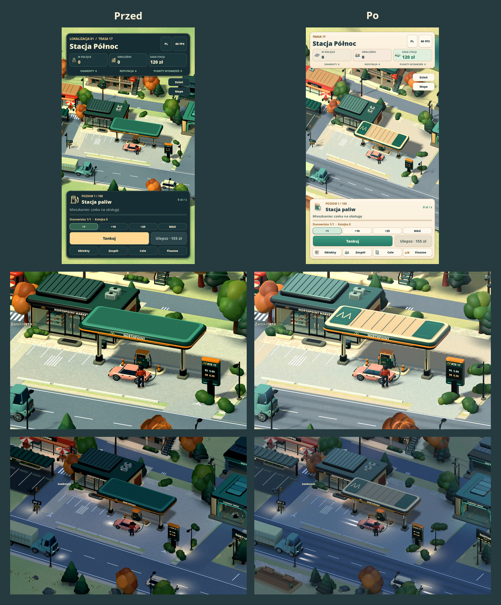
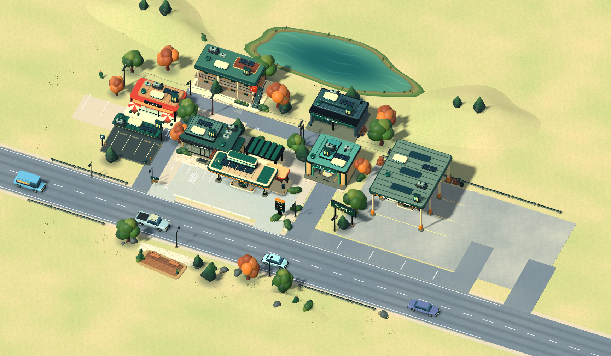

# Trasa 17 przed i po modernizacji

Przebudowa modeli z wersji 0.3.2 ma osobne porównanie z 0.3.1, trzy warianty stacji i galerię pięciu etapów. [Galeria 0.3.2](0.3.2/README.md)

Kadry pochodzą z okna Godota 4.7.2. Wersję bazową uruchomiono z commitu `9e82886`, a nowe kadry z wersji 0.3.1. Do porównania użyto tej samej stacji, floty i scenariusza rozgrywki. Pliki JPG są zapisami viewportu. Plansze porównawcze skalują i zestawiają te kadry obok siebie.

[Porównanie na jednej planszy](porownanie.jpg) · [Próba trzech kątów kamery](porownanie-kamery.jpg)

| Kadr | Przed | Po |
| --- | --- | --- |
| Start gry na telefonie | [Otwórz](before_visual_upgrade/01-stacja-w-grze.jpg) | [Otwórz](after_visual_upgrade/01-stacja-w-grze.jpg) |
| Światło dzienne, widok kompleksu | [Otwórz](before_visual_upgrade/02-mapa-dzien.jpg) | [Otwórz](after_visual_upgrade/02-mapa-dzien.jpg) |
| Zadaszenie, sklep i wąż tankowania | [Otwórz](before_visual_upgrade/03-stacja-detal.jpg) | [Otwórz](after_visual_upgrade/03-stacja-detal.jpg) |
| Złota godzina | [Otwórz](before_visual_upgrade/04-mapa-zlota-godzina.jpg) | [Otwórz](after_visual_upgrade/04-mapa-zlota-godzina.jpg) |
| Wieczór | [Otwórz](before_visual_upgrade/05-mapa-wieczor.jpg) | [Otwórz](after_visual_upgrade/05-mapa-wieczor.jpg) |
| Noc i reflektory | [Otwórz](before_visual_upgrade/06-stacja-noc.jpg) | [Otwórz](after_visual_upgrade/06-stacja-noc.jpg) |
| Monety po płatności | [Otwórz](before_visual_upgrade/07-monety-sprzedaz.jpg) | [Otwórz](after_visual_upgrade/07-monety-sprzedaz.jpg) |
| Efekt zakupu modułu | [Otwórz](before_visual_upgrade/08-rozbudowa-efekt.jpg) | [Otwórz](after_visual_upgrade/08-rozbudowa-efekt.jpg) |
| Poziom 5 stacji | [Otwórz](before_visual_upgrade/09-stacja-poziom-5.jpg) | [Otwórz](after_visual_upgrade/09-stacja-poziom-5.jpg) |
| Poziom 5 z HUD-em | [Otwórz](before_visual_upgrade/10-poziom-5-w-grze.jpg) | [Otwórz](after_visual_upgrade/10-poziom-5-w-grze.jpg) |
| Zbliżenie trzech typów pojazdów | [Otwórz](before_visual_upgrade/11-samochody-detal.jpg) | [Otwórz](after_visual_upgrade/11-samochody-detal.jpg) |
| Komplet 20 pojazdów | [Otwórz](before_visual_upgrade/12-flota-20-modeli.jpg) | [Otwórz](after_visual_upgrade/12-flota-20-modeli.jpg) |
| Postacie i stroje | [Otwórz](before_visual_upgrade/13-postacie.jpg) | [Otwórz](after_visual_upgrade/13-postacie.jpg) |
| Sześć podstawowych brył usług | [Otwórz](before_visual_upgrade/14-architektura.jpg) | [Otwórz](after_visual_upgrade/14-architektura.jpg) |
| Pracująca myjnia | [Otwórz](before_visual_upgrade/15-myjnia-woda.jpg) | [Otwórz](after_visual_upgrade/15-myjnia-woda.jpg) |
| Panel zespołu | [Otwórz](before_visual_upgrade/17-panel-zespolu.jpg) | [Otwórz](after_visual_upgrade/17-panel-zespolu.jpg) |
| Automatyczne tankowanie | [Otwórz](before_visual_upgrade/18-automatyzacja.jpg) | [Otwórz](after_visual_upgrade/18-automatyzacja.jpg) |
| Myjnia z HUD-em | [Otwórz](before_visual_upgrade/19-myjnia-w-grze.jpg) | [Otwórz](after_visual_upgrade/19-myjnia-w-grze.jpg) |
| Układ tabletowy | [Otwórz](before_visual_upgrade/20-tablet.jpg) | [Otwórz](after_visual_upgrade/20-tablet.jpg) |

Szeroki kadr pokazuje pełny plac, strefę ciężarową i dachy usług na progu 90. Stan usług ustawiono w profilu testowym galerii, a obraz zarejestrował działający silnik. [Cała rozbudowana mapa](after_visual_upgrade/16-pelny-kompleks.jpg)

